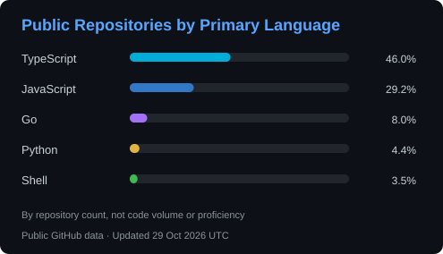

# Manenimabasi Udoh | Senior Backend Engineer

I build backend systems in Go, TypeScript and Python, with a focus on payments, wallets,
and reliable distributed workflows. At Infostrategy Technology, I lead hands-on
backend delivery across healthcare, commerce, and enterprise ERP systems.

## Tech Stack

- **Languages and APIs**: Go, TypeScript, Python, REST, gRPC
- **Backend and AI**: NestJS, FastAPI, LangChain, LLM integrations
- **Data and Messaging**: PostgreSQL, MongoDB, Redis, Kafka, NATS
- **Cloud and Delivery**: AWS, Docker, Kubernetes, Terraform, GitHub Actions

## Engineering Case Study

[Payment and Wallet Reliability in Go](https://github.com/manenim/manenim/blob/main/docs/payment-wallet-reliability.md): stable payment identity, wallet concurrency, transactional messaging, and replay-safe workflows.

## Featured Projects

| Project | Description | Stack |
|---|---|---|
| [task-orchestrator](https://github.com/manenim/task-orchestrator) | Distributed task scheduling with gRPC streaming, retries, timeouts, and cancellation | Go, gRPC, PostgreSQL, Redis |
| [gateway-rate-limiter](https://github.com/manenim/gateway-rate-limiter) | Distributed token-bucket rate limiting with atomic Redis/Lua operations, in-memory support, and decision metrics | Go, Redis, Lua |
| [nestjs-saas-platform](https://github.com/manenim/nestjs-saas-platform) | Multi-tenant backend with tenant-aware context, authentication, RBAC, and billing workflows | TypeScript, NestJS, PostgreSQL, Redis |
| [pr-review-agent](https://github.com/manenim/pr-review-agent) | AI-assisted PR review with webhook validation, background processing, and structured inline findings | Python, FastAPI, LangChain, Gemini |
| [hms-ai-platform-backend](https://github.com/manenim/hms-ai-platform-backend) | Hotel operations backend with bookings, room inventory, real-time events, and applied AI integrations | TypeScript, NestJS, PostgreSQL, Gemini |

## Certifications

- Certified Kubernetes Administrator (CKA), Linux Foundation / CNCF: [View badge](https://www.credly.com/badges/3db71936-40a0-4806-850f-39dc584f5857/public_url)
- AWS Certified Solutions Architect - Associate: [View badge](https://www.credly.com/badges/bde40158-6f10-4a49-b8be-bdb92366d278/public_url)

## GitHub Activity

Contribution streak and repository languages

 

Language percentages show the share of my original public repositories by primary language, not code volume, proficiency or the full scope of my professional and upstream work.

## Let's Connect

> Open to remote Senior Backend Engineer, Lead Backend Engineer, and Go engineering roles.
