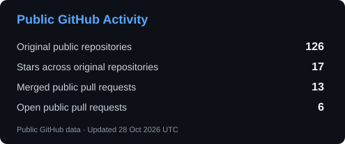

# Manenimabasi Udoh | Senior Backend Engineer

I build backend systems in Go, TypeScript and Python, with a focus on payments, wallets,
and reliable distributed workflows. At Infostrategy Technology, I lead hands-on
backend delivery across healthcare, commerce, and enterprise ERP systems.

## Tech Stack

## Certifications

- Certified Kubernetes Administrator (CKA), Linux Foundation / CNCF: [View badge](https://www.credly.com/badges/3db71936-40a0-4806-850f-39dc584f5857/public_url)
- AWS Certified Solutions Architect - Associate: [View badge](https://www.credly.com/badges/bde40158-6f10-4a49-b8be-bdb92366d278/public_url)

## Contribution streak and repository

## GitHub Activity

## Let's Connect

> Open to remote Senior Backend Engineer, Lead Backend Engineer, and Go engineering roles.
